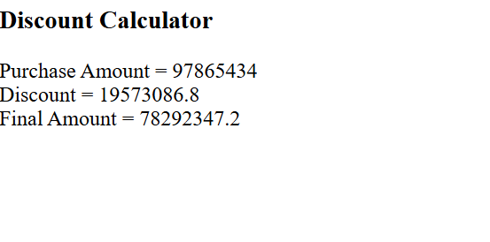

# Discount Calculator using JavaScript

## 📌 Project Overview
The Discount Calculator is a simple web-based program that calculates the discount on a purchase based on the purchase amount. It uses JavaScript conditional statements to determine the discount percentage.

## 🎯 Objectives
- Calculate discounts based on purchase amount.
- Apply different discount percentages.
- Display the final amount after deducting the discount.

## 📋 Discount Criteria

| Purchase Amount | Discount |
|---|---|
| ₹5,000 or more | 20% |
| ₹2,000 to ₹4,999 | 10% |
| Below ₹2,000 | 0% |


## 📂 Project Structure

```text
Calculate_Discount/
├── index.html
├── output.png
└── README.md
```

## output


## 💻 Example

**Input:**
```text
Enter purchase amount: 3000
```

**Output:**
```text
Purchase Amount = 3000
Discount = 300
Final Amount = 2700
```

## ⚙️ Technologies
- HTML5
- JavaScript


## 🚀 Execution Steps
1. Create an HTML file.
2. Write the HTML structure and JavaScript code.
3. Save the file as `index.html`.
4. Open it in a web browser.
5. Enter the purchase amount in the prompt box.
6. Check the calculated discount and final amount.

## 🧠 Concepts Used
- Variables (`let`)
- User input (`prompt()`)
- Conditional statements (`if`, `else if`, `else`)
- Arithmetic operators
- DOM manipulation (`innerHTML`)

## ✅ Conclusion
This project demonstrates how JavaScript conditional statements can be used to calculate discounts and display the final purchase amount dynamically on a webpage.

---
**Author:** 
Gaurav Pipavat