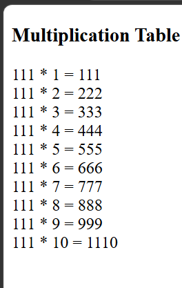

# Multiplication Table Generator

## 1. Project Overview
The Multiplication Table Generator is a beginner-friendly project developed using HTML and JavaScript. It accepts a number from the user and generates its multiplication table from 1 to 10.

## 2. Problem Statement
Write a JavaScript program that takes a number as input and prints its multiplication table using a `for` loop.

## 3. Objectives
- Understand the working of a `for` loop.
- Perform multiplication using JavaScript.
- Accept input from the user.
- Display the result dynamically on a webpage.

## 4. Technologies Used
- HTML5
- JavaScript
- visual studio 
- github


## 📂 Project Structure

```text
Print Multiplication Table
├── index.html
├── output.png
└── README.md
```

## output


## 5. Program Logic
1. Ask the user to enter a number using `prompt()`.
2. Initialize an empty string to store the output.
3. Use a `for` loop from 1 to 10.
4. Multiply the entered number by the loop counter.
5. Append each result to the output string.
6. Display the complete table using `innerHTML`.

## 6. Sample Input
```text
Enter a number: 7
```

## 7. Sample Output
```text
7 * 1 = 7
7 * 2 = 14
7 * 3 = 21
7 * 4 = 28
7 * 5 = 35
7 * 6 = 42
7 * 7 = 49
7 * 8 = 56
7 * 9 = 63
7 * 10 = 70
```

## 8. Concepts Learned
- Variables and strings
- User input with `prompt()`
- Iteration using a `for` loop
- Arithmetic operations
- String concatenation
- Displaying output using `innerHTML`

## 9. How to Execute
1. Create an `index.html` file.
2. Add the HTML and JavaScript code.
3. Save the file.
4. Open the file in a web browser.
5. Enter any number in the prompt box.
6. The multiplication table will appear on the webpage.

## 10. Applications
- Practicing multiplication tables.
- Learning basic programming logic.
- Understanding loops and arithmetic operations.

## 11. Conclusion
This project demonstrates how JavaScript loops can automate repetitive calculations and display results dynamically on a webpage.

## Author
**Gaurav Pipavat**