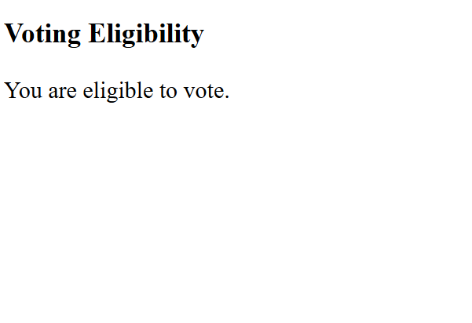

# Voting Eligibility Checker

## Project Description
This project checks whether a person is eligible to vote based on their age. It uses JavaScript conditional statements to display the result on a webpage.

## 📂 Project Structure

```text
check_age/
├── index.html
├── output.png
└── README.md
```

## output



## Conditions
- **Age 18 or above:** Eligible to vote.
- **Age below 18:** Not eligible to vote.

## Technologies Used
- HTML
- JavaScript
- visual studio code
- github

## Program Features
- Takes age as input using `prompt()`.
- Checks voting eligibility using an `if-else` statement.
- Displays the result using `innerHTML`.

## Example Output

**Input:**
```text
Enter your age: 20
```

**Output:**
```text
You are eligible to vote.
```

## How to Run
1. Create a file named `index.html`.
2. Copy the HTML and JavaScript code into the file.
3. Save the file.
4. Open `index.html` in your web browser.
5. Enter your age in the prompt box.
6. View the result on the webpage.

## Concepts Used
- Variables (`let`)
- User input (`prompt()`)
- Conditional statements (`if-else`)
- Comparison operator (`>=`)
- DOM manipulation (`innerHTML`)

## Conclusion
This program demonstrates how JavaScript conditional statements can be used to check voting eligibility based on age.

---
**Author:** Gaurav Pipavat