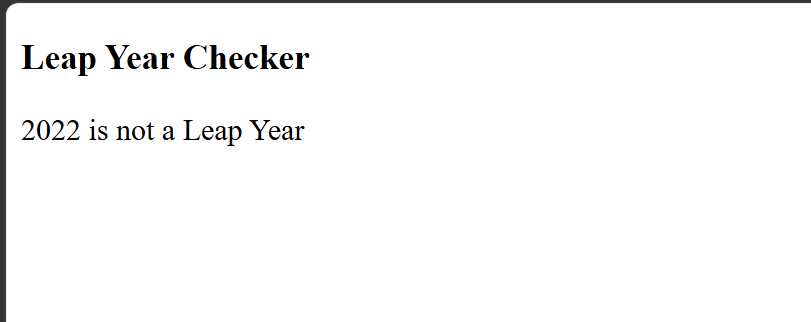

# Leap Year Program in JavaScript

### Overview
This program checks whether the year entered by the user is a leap year or not. The result is displayed on the webpage using HTML and JavaScript.

## Technologies Used
- HTML
- JavaScript
- visual studio code
- github

### Problem Statement
Write a program to check whether a given year is a leap year using conditional statements.

## 📂 Project Structure

```text
check_leep_year
├── index.html
├── output.png
└── README.md
```

## output


### Source Code File
`index.html`

### Conditions
1. If the year is divisible by 400, it is a leap year.
2. If the year is divisible by 4 but not by 100, it is a leap year.
3. Otherwise, it is not a leap year.

### Sample Input
```text
2024
```

### Sample Output
```text
2024 is a Leap Year
```

### Technologies
- HTML
- JavaScript

### JavaScript Concepts
- `prompt()` — Takes input from the user.
- `if-else` — Checks the conditions.
- `%` — Checks the remainder.
- `&&` and `||` — Combine conditions.
- `innerHTML` — Displays the result on the webpage.

### Steps to Execute
1. Write the program in `index.html`.
2. Save the file.
3. Open it in a web browser.
4. Enter a year when prompted.
5. Check whether the year is a leap year.

### Result
The program successfully determines whether the entered year is a leap year.

---
**Author:** Gaurav Pipavat