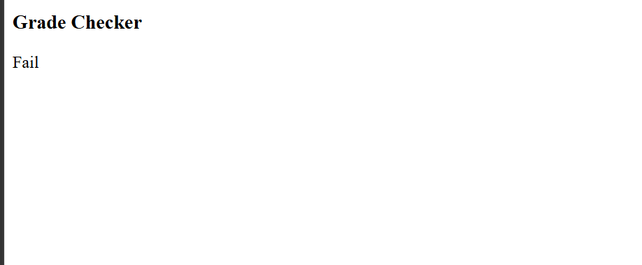

# Grade Checker Using JavaScript

## Description
This program takes marks as input from the user and displays the grade according to the given conditions. It is created using HTML and JavaScript.

## Grade Criteria

| Marks | Grade |
|---|---|
| 90–100 | Grade A |
| 75–89 | Grade B |
| 60–74 | Grade C |
| 35–59 | Grade D |
| Below 35 | Fail |
| Below 0 or Above 100 | Invalid Marks |

## Example

**Input:**
```text
Enter your marks: 85
```

**Output:**
```text
Grade B
```

## 📂 Project Structure

```text
grade_calculation
├── index.html
├── output.png
└── README.md
```

## output


## Technologies Used
- HTML5
- JavaScript
- visual studio 
- github


## Concepts Used
- Variables (`let`)
- User input (`prompt()`)
- Conditional statements (`if-else if-else`)
- Logical operators (`||`)
- Comparison operators (`>=`, `<`, `>`)
- DOM manipulation (`innerHTML`)

## How to Run
1. Create a file named `index.html`.
2. Write the HTML and JavaScript code in the file.
3. Save the file.
4. Open it in a web browser.
5. Enter your marks in the prompt box.
6. View the grade displayed on the webpage.

## Result
The program successfully checks the entered marks and displays the appropriate grade.

---
**Author:** 
Gaurav Pipavat