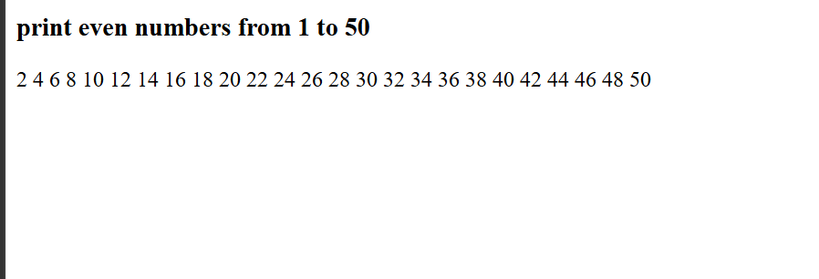

# Print Even Numbers from 1 to 50

## Description
This program prints all even numbers from 1 to 50 using a JavaScript `for` loop and displays the output on a webpage.

## Technologies Used
- HTML
- JavaScript
- visual studio 
- git hub

## 📂 Project Structure

```text
Print_even_number
├── index.html
├── output.png
└── README.md
```

## output



## Program Logic
- Initialize an empty string named `output`.
- Start the loop from 2.
- Run the loop until 50.
- Increment the value by 2 in each iteration.
- Display all even numbers using `innerHTML`.

## Sample Output
```text
2 4 6 8 10 12 14 16 18 20
22 24 26 28 30 32 34 36 38 40
42 44 46 48 50
```

## Concepts Used
- Variables (`let`)
- `for` loop
- Increment operator (`+=`)
- String concatenation
- DOM manipulation (`innerHTML`)

## How to Run
- Save the code in an `index.html` file.
- Open the file in a web browser.
- The even numbers from 1 to 50 will appear on the webpage.

## Result
Successfully prints all even numbers from 1 to 50 using JavaScript.

## Author
**Gaurav Pipavat**