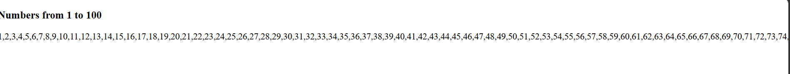

# Numbers from 1 to 100

## Description
This program prints numbers from 1 to 100 using a JavaScript `for` loop. The output is displayed on a webpage using HTML and JavaScript.

## Technologies Used
- HTML5
- JavaScript
- visual studio 
- git hub

## 📂 Project Structure

```text
Print_number_1_100
├── index.html
├── output.png
└── README.md
```

## output



## Program Logic
- Initialize an empty string named `output`.
- Start the loop from 1.
- Continue the loop until 100.
- Increase the number by 1 in each iteration.
- Add each number to the output string followed by a comma.
- Display the output using `innerHTML`.

## Sample Output
```text
1,2,3,4,5,6,7,8,9,10,11,12,13,14,15...
```

The program displays all numbers up to 100.

## Concepts Used
- Variables (`let`)
- `for` loop
- Increment operator (`i++`)
- String concatenation (`+=`)
- DOM manipulation (`innerHTML`)

## How to Run
- Save the code in a file named `index.html`.
- Open the file in a web browser.
- The numbers from 1 to 100 will appear on the webpage.

## Result
Successfully displays numbers from 1 to 100 using a JavaScript `for` loop.

## Author
**Gaurav Pipavat**